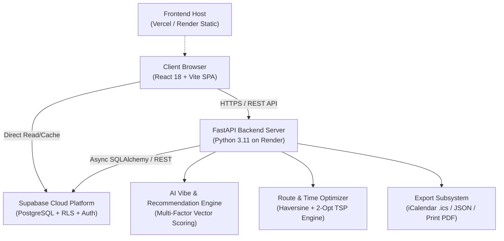
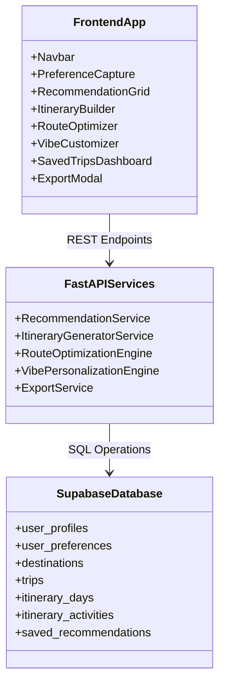
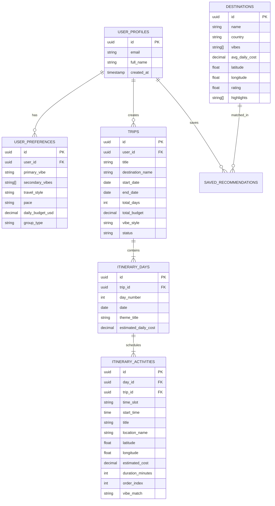

# System Architecture: Personalized Travel Itinerary Planner

This document provides a comprehensive architectural breakdown of the **Personalized Travel Itinerary Planner**, detailing the client-server interaction, database schema, data flow pipelines, and AI recommendation logic.

---

## 1. High-Level System Architecture

---

## 2. Component Hierarchy & Layering

---

## 3. Database Entity Relationship Diagram (ERD)

---

## 4. Algorithmic Engines

### 4.1 Destination Recommendation Engine (Activity 3.3)
The engine calculates a match coefficient $M \in [0, 100]$ using multi-criteria weighted scoring:

$$M = w_v \cdot S_{\text{vibe}} + w_b \cdot S_{\text{budget}} + w_p \cdot S_{\text{pace}} + w_r \cdot S_{\text{rating}}$$

Where:
- $S_{\text{vibe}}$: Jaccard similarity between user vibe tags and destination vibe tags plus primary vibe weighting.
- $S_{\text{budget}}$: Cost-efficiency curve matching user daily budget with destination average daily expenditure.
- $S_{\text{pace}}$: Density of scheduled attractions corresponding to user's desired pace (`Relaxed` = 2 activities/day, `Moderate` = 3-4 activities/day, `Fast-Paced` = 5+ activities/day).
- $S_{\text{rating}}$: Normalized destination review score.

### 4.2 Route & Time Optimization Engine (Activity 4.2)
To minimize transit fatigue and carbon footprint, the optimizer computes the distance between geographic coordinates using the **Haversine Formula**:

$$d = 2R \arcsin\left(\sqrt{\sin^2\left(\frac{\Delta \phi}{2}\right) + \cos(\phi_1)\cos(\phi_2)\sin^2\left(\frac{\Delta \lambda}{2}\right)}\right)$$

An approximation of the 2-opt heuristic reorders day activities into an optimal geographic sequence, calculating walking or transit time between sequential pins to eliminate zigzag backtracking.

---

## 5. Security & Isolation
- **Row Level Security (RLS)**: Enforced directly at the PostgreSQL layer in Supabase. Users can only query and mutate their own trips and preferences.
- **CORS Protection**: FastAPI dynamically restricts incoming cross-origin headers to authorized frontend deployment domains.
- **Fail-Safe Offline Mode**: Built-in state fallback ensures zero UI crashes even in disconnected or sandboxed environments.
